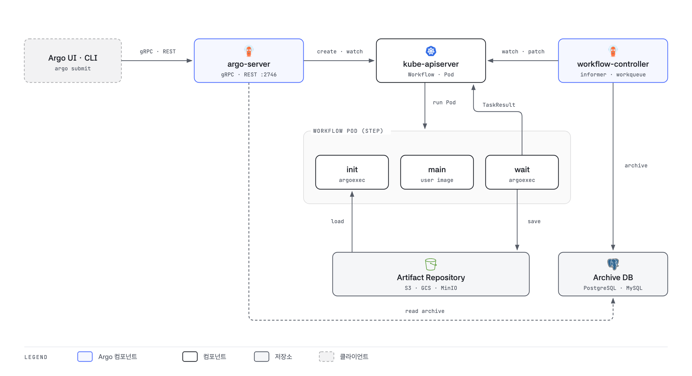
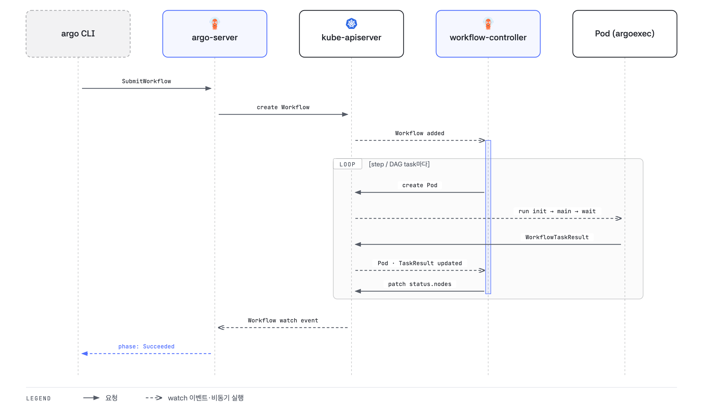



Argo Workflows는 Kubernetes Operator 패턴으로 만든 워크플로 엔진이다. 워크플로 정의와 실행 상태는 Workflow라는 CRD(Custom Resource)에 저장된다. 
workflow-controller는 이 리소스를 감시하며 실제 실행을 진행한다. argo-server는 같은 리소스를 사용자에게 API와 UI로 보여 준다. 
두 컴포넌트는 서로 직접 통신하지 않고, kube-apiserver에 저장된 Workflow 리소스를 공유 상태로 삼는다. 첫 번째 그림이 이 구성이다.

 

## 구성 요소

### Workflow 계열 CRD

| 리소스 | 역할 |
|---|---|
| `Workflow` | 실행 단위 하나. `spec`에 templates·DAG·steps를 정의하고, `status`에 `phase`와 단계별 실행 결과 트리인 `status.nodes`를 기록한다. |
| `WorkflowTemplate` / `ClusterWorkflowTemplate` | 재사용할 템플릿. 직접 실행되지 않고 Workflow가 참조한다. |
| `CronWorkflow` | 스케줄에 따라 Workflow를 생성한다. |
| `WorkflowTaskResult` | 단계 Pod가 출력값과 실행 결과를 보고할 때 쓰는 내부 리소스. |
| `WorkflowTaskSet` | HTTP·plugin 템플릿을 처리하는 agent Pod와 주고받는 내부 리소스. |

실행 상태가 모두 kube-apiserver(etcd)에 저장되므로 workflow-controller가 재시작되어도 진행 상황이 사라지지 않는다.

 

### workflow-controller

Deployment로 실행되며, 워크플로를 실제로 진행하는 유일한 주체다.

- **이벤트 수신**: Workflow, WorkflowTemplate, CronWorkflow, Pod, WorkflowTaskResult를 informer로 watch한다. 
  변경이 생기면 해당 Workflow 키를 workqueue에 넣고, 여러 worker goroutine(`--workflow-workers`)이 큐에서 꺼내 처리한다. 
  workqueue 특성상 같은 Workflow를 두 worker가 동시에 처리하지 않는다.
- **reconcile 한 번에 하는 일**:
  - `spec`과 `status.nodes`를 비교해 의존성이 충족된 node를 찾는다.
  - 그 node의 Pod를 생성한다. 이때 `parallelism`과 mutex·semaphore 제한을 지킨다.
  - Pod와 WorkflowTaskResult에서 읽은 결과로 `status.nodes`를 갱신한다.
- **부가 기능**: CronWorkflow 스케줄링, 완료된 Workflow·Pod 정리(TTL, `podGC`), 아카이브 기록도 맡는다.
- **고가용성**: replica를 여러 개 띄워도 leader election으로 하나만 활성화된다. 상태를 쓰는 주체를 하나로 두려는 설계다.

 

### argo-server

UI와 API를 제공하는 상태 없는 서버다. 
기본 포트 2746에서 gRPC와 REST를 함께 노출하고, argo CLI·Argo UI·Hera(Python SDK)가 이 API를 호출한다.

- Workflow 생성과 조회는 kube-apiserver를 호출해 처리하고, workflow-controller와는 직접 통신하지 않는다. 
  CLI는 `ARGO_SERVER`가 설정되지 않으면 argo-server를 거치지 않고 kubeconfig로 kube-apiserver에 직접 접속한다.
- 인증은 `--auth-mode`로 정하고, 여러 값을 함께 쓸 수 있다.
  - `client`(기본값): 사용자의 토큰으로 kube-apiserver를 호출한다.
  - `server`: argo-server의 ServiceAccount 권한으로 호출한다.
  - `sso`: OIDC로 로그인한 뒤 RBAC에 매핑한다.
- UI용 부가 기능으로 아카이브 DB 조회, 아티팩트 다운로드 중계, WorkflowEventBinding 기반 이벤트 수신 API를 제공한다.

 

### 단계 Pod

step이나 DAG task 하나가 Pod 하나로 실행된다. 기본 구성은 컨테이너 세 개다.

| 컨테이너 | 역할 |
|---|---|
| `init` | `argoexec init`으로 입력 아티팩트와 script 파일을 준비한다. |
| `main` | 사용자 이미지다. emissary executor가 공유 볼륨에 복사된 `argoexec`로 사용자 명령을 감싸 실행하고, 종료 코드와 출력을 수집한다. |
| `wait` | `argoexec wait`로 main의 종료를 기다린다. 이후 출력 아티팩트와 로그를 Artifact Repository에 저장하고 결과를 WorkflowTaskResult로 보고한다. |

- **executor**: v3.4부터 executor는 emissary 하나만 남았다. 
  이전의 docker·pns·k8sapi 방식과 달리 컨테이너 런타임 소켓이나 Pod 간 프로세스 접근이 필요 없다.
- **WorkflowTaskResult**: 결과 보고는 Pod annotation을 수정하던 방식에서 WorkflowTaskResult로 바뀌었다. 
  v3.5.3부터는 wait가 실행 시작 시점에 미완료 상태의 WorkflowTaskResult를 먼저 만들어 둔다.
- **Init-less 모드**: 최근 버전에는 init 컨테이너 없이 supervisor 컨테이너가 main과 함께 실행되는 이 모드가 opt-in으로 추가됐다. 
  Kubernetes image volume 기능이 필요하다.
- **agent Pod**: HTTP 템플릿과 plugin 템플릿은 단계마다 Pod를 만들지 않는다. 
  Workflow마다 agent Pod 하나가 WorkflowTaskSet을 통해 처리한다.

 

### 저장소

- **Artifact Repository**: S3·GCS·MinIO 같은 객체 저장소다. 
  단계 간에 파일을 전달할 때 쓰고, 설정은 controller ConfigMap이나 Workflow에 지정한다.
- **Archive DB**(선택): PostgreSQL 또는 MySQL이다. 두 가지 용도가 있다.
  - 완료된 Workflow를 etcd에서 지운 뒤에도 조회할 수 있게 아카이브한다.
  - `status.nodes`가 etcd 객체 크기 제한(기본 1.5MiB)에 가까워지면 node 상태를 DB로 옮긴다(node status offload).

 

## 동작 방식

두 번째 그림의 순서다.

1. **제출**: `argo submit`이 argo-server의 SubmitWorkflow를 호출하고, argo-server는 kube-apiserver에 Workflow 리소스를 생성한다.
2. **감지**: workflow-controller의 informer가 새 Workflow를 받아 workqueue에 넣는다. 
   worker가 reconcile을 시작하고, 진입 template부터 실행 가능한 node를 계산한다.
3. **실행**: controller가 실행 가능한 node의 Pod를 생성하면 kubelet이 init → main → wait 순으로 실행한다. 
   wait는 출력을 저장하고 WorkflowTaskResult를 기록한다.
4. **갱신**: Pod 상태 변화와 WorkflowTaskResult 생성이 informer 이벤트로 돌아오면, 소유한 Workflow가 다시 큐에 들어간다. 
   controller는 `status.nodes`에 결과를 반영하고, 새로 의존성이 충족된 node의 Pod를 만든다. 
   모든 node가 끝날 때까지 3~4단계를 반복한다.
5. **종료**: 모든 node가 끝나면 `phase`가 Succeeded 또는 Failed로 바뀐다. 
   정의돼 있으면 `onExit` 핸들러가 실행되고, 이후 아카이브·Pod GC·TTL 정리가 이어진다.
6. **조회**: argo-server는 Workflow를 watch해 상태 변화를 UI와 `argo watch`에 스트리밍한다.

controller는 level-triggered로 동작한다. 
이벤트는 reconcile을 시작하는 신호일 뿐이고, 매번 현재 `spec`과 `status` 전체를 다시 평가해 다음 행동을 결정한다. 
그래서 이벤트가 유실되거나 controller가 재시작돼도 다음 reconcile이나 주기적 resync에서 같은 결론에 도달한다.

 

## 설계

- **Operator 패턴**: 상태는 CR(Custom Resource)에, 로직은 controller에 둔다. 
  kube-apiserver의 watch, RBAC, 영속성을 그대로 이용하므로 별도 DB 없이도 동작한다.
- **controller와 server의 분리**: 상태를 쓰는 주체는 workflow-controller 하나로 제한했다. 
  argo-server는 상태 없는 API 계층이라 수평 확장할 수 있다. 
  둘 사이의 결합은 Workflow 리소스뿐이어서, argo-server 없이 kubectl이나 CLI만으로도 Workflow를 운영할 수 있다.
- **step당 Pod 하나**: 단계마다 이미지, 리소스 요청, 노드 배치를 독립적으로 정할 수 있다. 
  대신 단계마다 Pod 기동 지연이 생긴다. 아주 짧은 단계가 많은 워크로드에서는 이 지연이 전체 실행 시간에 드러난다.
- **sidecar와 wrapper**: 출력 수집을 wait sidecar와 emissary wrapper가 맡는다. 
  그래서 사용자 이미지를 수정하지 않아도 되고, 컨테이너 런타임에도 의존하지 않는다.
- **상태 크기 관리**: 실행 상태를 CR 안에 두는 구조라 etcd 크기 제한이 생긴다. 
  node status offload와 아카이브가 이 제한에 대응한다.

 

## 관련 기술

| 기술 | 관계 |
|---|---|
| **Argo Events** | EventSource·Sensor로 외부 이벤트(Webhook, Kafka, S3 등)를 받아 Workflow를 생성한다. 실행 엔진 앞단의 트리거 계층이다. |
| **Argo CD** | GitOps 배포 도구다. WorkflowTemplate·CronWorkflow 같은 정의를 Git에서 클러스터로 동기화하는 데 함께 쓴다. |
| **Hera** | Python SDK다. v4.0에서 기존 Python SDK가 저장소에서 제거되면서 권장 SDK가 됐다. |
| **Kubeflow Pipelines** | 파이프라인 실행 백엔드로 Argo Workflows를 사용한다. |
| **Tekton / Airflow** | Tekton은 같은 Kubernetes 네이티브 방식이지만 CI/CD 파이프라인에 초점을 둔다. Airflow는 별도 스케줄러와 메타데이터 DB를 중심으로 동작한다. |

 

## References

- [Argo Workflows — Architecture](https://argo-workflows.readthedocs.io/en/latest/architecture/)
- [Argo Server](https://argo-workflows.readthedocs.io/en/release-4.0/argo-server/) · [Argo Server Auth Mode](https://argo-workflows.readthedocs.io/en/latest/argo-server-auth-mode/)
- [Workflow Executors](https://argo-workflows.readthedocs.io/en/latest/workflow-executors/) · [Init-less Pod](https://argo-workflows.readthedocs.io/en/latest/initless-pod/)
- [Upgrading Guide (v4.0)](https://argo-workflows.readthedocs.io/en/release-4.0/upgrading/)
- [GitHub issue #12993 — v3.5.3 WorkflowTaskResult 생성 순서 변경](https://www.github.com/argoproj/argo-workflows/issues/12993)
- [KodeKloud — Argo Workflow Architecture (CAPA)](https://notes.kodekloud.com/docs/Prep-Course-Certified-Argo-Project-Associate-CAPA/Argo-Workflow/Architecture/page)
- 아이콘: [CNCF artwork](https://github.com/cncf/artwork)(Argo, Kubernetes) · [Devicon](https://devicon.dev)(PostgreSQL) · [Simple Icons](https://simpleicons.org)(Amazon S3)


